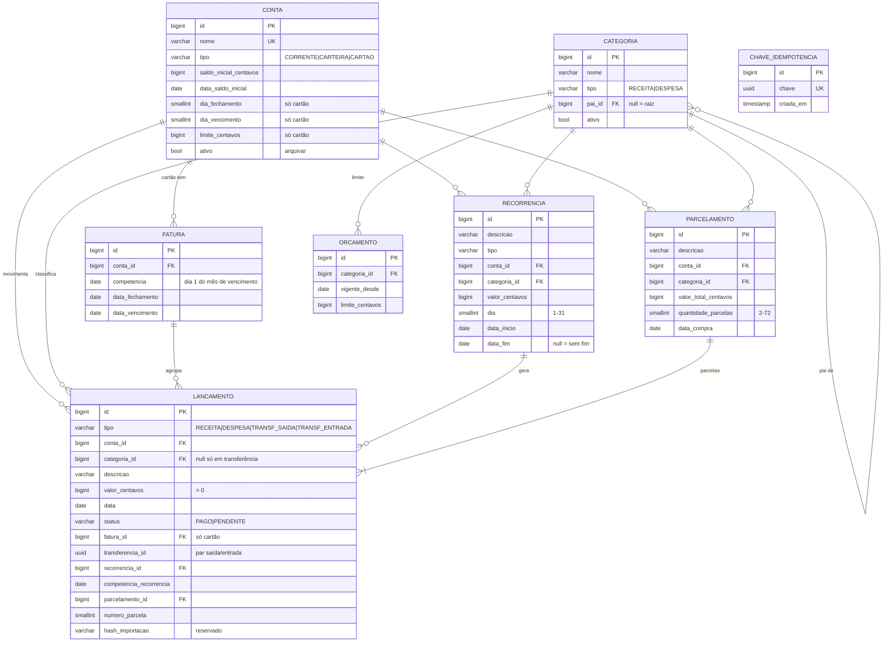

# Modelo de dados

Valores monetários em **centavos inteiros** (`BIGINT`). Datas de lançamento são
datas de calendário; timestamps (`criado_em`, `atualizado_em`) em UTC.

## Regras garantidas pelo banco

| Regra | Mecanismo |
|---|---|
| Não excluir conta/categoria com lançamentos | `ON DELETE PROTECT` (arquivar com `ativo=false`) |
| Cartão exige dia de fechamento e vencimento | `CHECK conta_cartao_exige_dias` |
| Valor sempre positivo (o tipo dá o sinal) | `CHECK lancamento_valor_positivo` |
| Transferência não tem categoria; receita/despesa têm | `CHECK lancamento_transferencia_consistente` |
| Transferência = exatamente um par saída/entrada | `UNIQUE (transferencia_id, tipo)` |
| Parcela não se repete | `UNIQUE (parcelamento_id, numero_parcela)` |
| Recorrência gera no máx. 1 lançamento por mês | `UNIQUE (recorrencia_id, competencia_recorrencia)` |
| Uma fatura por cartão por mês | `UNIQUE (conta_id, competencia)` |
| Formulário enviado duas vezes | `UNIQUE chave_idempotencia.chave` |
| Extrato importado duas vezes (futuro) | `UNIQUE (conta_id, hash_importacao)` |

## Regras calculadas (não armazenadas)

- **Saldo da conta** = saldo inicial + Σ entradas − Σ saídas.
- **Valor da fatura** = Σ lançamentos da fatura.
- **Uso do orçamento** = Σ despesas da categoria (e subcategorias) no mês ÷ limite vigente.
